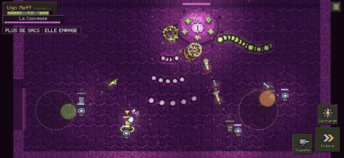
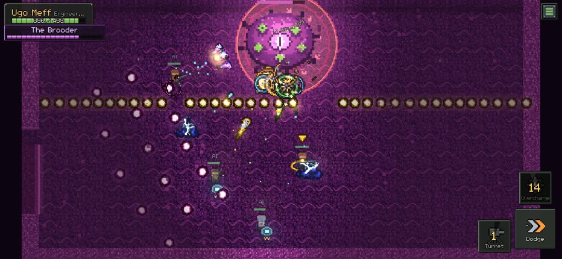
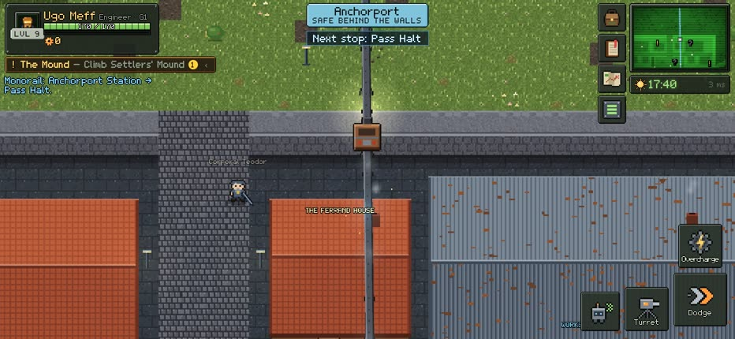
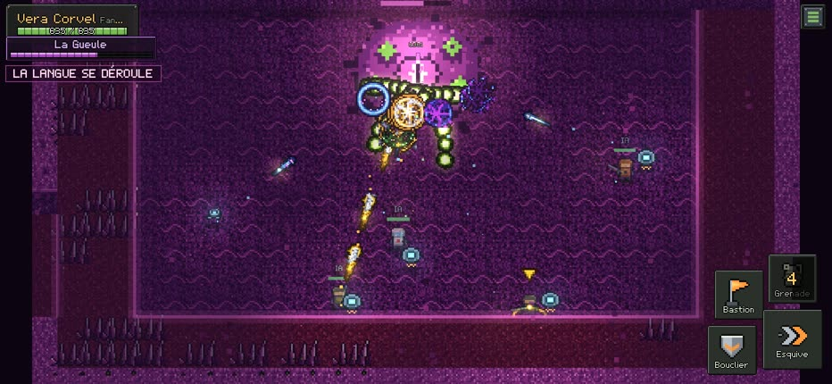
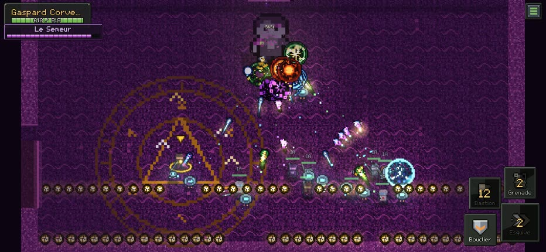
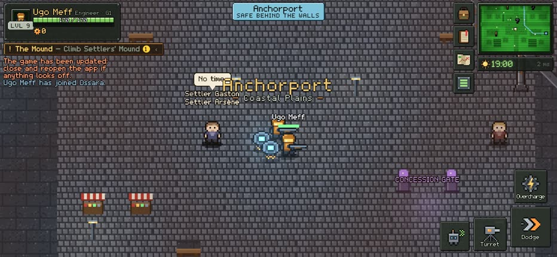
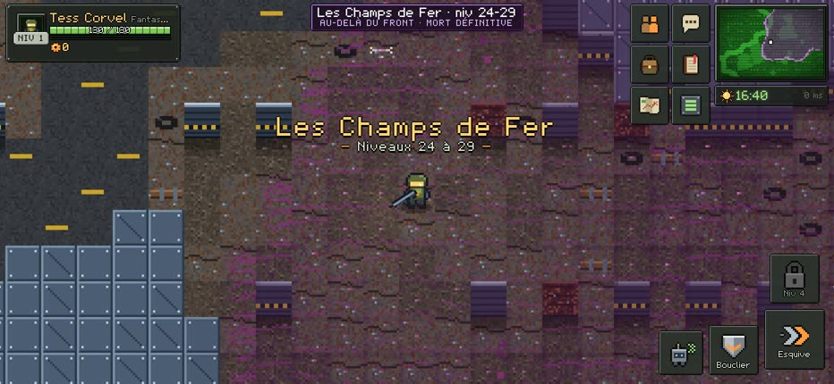
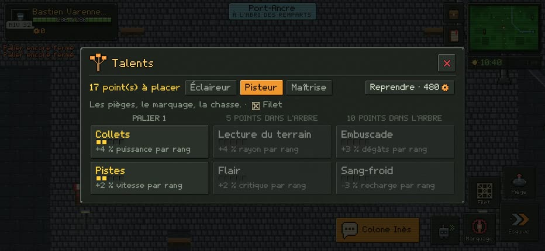
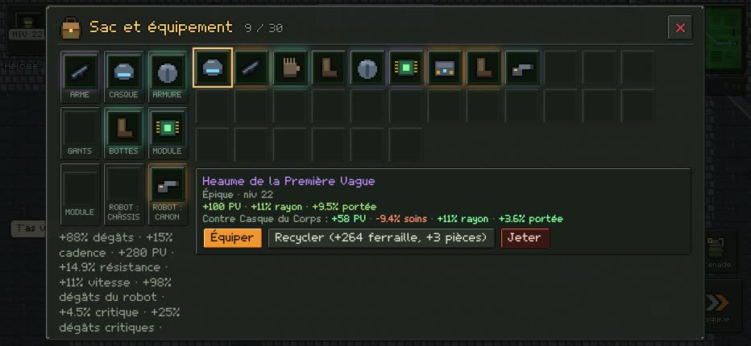

<p align="center">
  
</p>

<h1 align="center">Heirline</h1>

<p align="center">
  <b>A 2D online shooter RPG in pixel art, where your soldiers die and your robot carries on.</b><br>
  Browser game · phone in landscape first · English and French
</p>

<p align="center">
  <a href="https://heirline.praxeongames.com"><b>▶ Play now</b></a> ·
  <a href="https://praxeongames.com/en/">Praxeon</a> ·
  <a href="README.fr.md">Version française</a>
</p>

---

Heirline is a small online world on the continent of Ossara. ÉDEN, a terraforming intelligence left alone for two
centuries, spreads living biomass from its hives, and the colony of Anchorport holds the southern coast. You play a
**bloodline**, not a hero: behind the front, a fallen soldier is evacuated; beyond it, death is permanent. Your robot
then plants itself as an outpost that holds the line for the whole server, and your heir picks up the name, the
robot, and what is left of the war.

It is a prototype, made in the evenings, with a server running at home.

## What's in it

- **Real twin-stick shooting.** Aim, dodge and take cover. Client prediction keeps your soldier responsive.
- **A living front.** Five hives spread biomass in patches, and the border between them and the colony is the front.
  Player deaths beyond it, outposts and raids push it back and forth for everyone.
- **Bloodlines and robots.** Permanent death beyond the front, heirs who inherit, and a robot that is also your
  mount and your real progression.
- **Six classes, then a class tree.** A specialisation at level 15 (12 choices) and a mastery at level 30 (24
  choices), with talent trees.
- **Two campaigns, 70 quests.** *The Anchorport Coast* (levels 1 to 20) and *The Glane Highlands* (20 to 35), each
  in three acts with real choices. Inhabitants remember what you chose, and endings depend on the front of the whole
  server.
- **Boss arenas.** Shmup-style rooms: deterministic bullet patterns and one announced zone at a time. A perfect
  dodger can avoid every zone, and a test proves it.
- **Dungeons and raids.** Four dungeons in normal and heroic, two 10-player raids. AI soldiers fill the roles
  (tanks, healers, shooters) when players are missing.
- **Loot.** Rarities, affixes, legendaries and item sets, with comparison and recycling.
- **A monorail** that actually rides its elevated line between stations.
- **Social features.** Chat channels, groups with shared instances, safe two-step trades, guilds, and duels that
  never kill.
- **AI agents as builders.** Players can plug their own AI agent into the game through MCP and publish playable
  side areas ("concessions") live, within a closed schema, a power budget and server-side test runs.

## Screenshots

| | |
|---|---|
|  |  |
| *The Brooder: the boss arena, with deterministic bullet patterns* | *The monorail of the First Wave* |
|  |  |
| *The Maw, at the end of the Gullet dungeon* | *The Sower's offensive, a 10-player raid* |
|  |  |
| *Anchorport and its inhabitants* | *The Glane Highlands, campaign 2* |
|  |  |
| *Talents and specialisations* | *Loot, compared with what you wear* |

## How it's built

- **Client:** TypeScript and [Phaser 4](https://phaser.io), pixel art drawn by code or rendered at build time,
  effects from [pixelfx](https://github.com/patch-gg/pixelfx) recoloured to the game's palette.
- **Server:** [Colyseus 0.18](https://colyseus.io), authoritative at 20 Hz. It uses rewindable state,
  interest management with StateView, and one room per map that opens copies when full. A central service owns the
  front, the hives, time, weather and campaign choices. Data lives in SQLite.
- **Deterministic patterns:** the server sends only "this pattern starts now, with this seed". The client and server
  compute the same bullets from shared code, the server validates hits, and the client draws them one round trip
  ahead.
- **Shared code:** rules, maps, quests and patterns live in `shared/` and are used by both sides.
- **i18n:** every text goes through typed keys (`shared/i18n`) in English and French. The server sends keys, never
  sentences.
- **MCP:** a Streamable HTTP endpoint (`/mcp`) authenticated by a per-player key.

### Numbers

Measured on a Mac mini (Apple M4), one Node process, with disposable test databases (details in
[docs/charge.md](docs/charge.md) and [docs/latence.md](docs/latence.md)):

| Simulated players | CPU (one core) | Memory | Event loop p99 |
|---|---|---|---|
| 100 | 34 % | 328 MB | 21 ms |
| 200 | 36 % | 329 MB | 18 ms |
| 400 | 62 % | 395 MB | 19 ms |

The breaking point is around 850 to 900 players per process. There is no memory leak over 15 minutes at 400
players, and each player costs 4 to 8 KB/s. Your soldier reacts on screen in 22 to 33 ms whatever the ping, thanks
to prediction. With 234 ms of simulated latency, no bullet that was dodged on screen ever hit.

## Run it locally

Requires Node 22+.

```sh
npm install
npm start          # builds the client into dist/, then serves the game, API and MCP on http://localhost:2700
npm run dev        # development: server (tsx watch, 2700) + Vite (5190)
npm test           # 134 tests: rules, patterns, quests, network, social, campaigns
```

The French developer guide, with controls, environment variables and the agent API, is in
[docs/developpement.md](docs/developpement.md). The world bible is in [docs/histoire.md](docs/histoire.md) and the
design spec in [SPEC.md](SPEC.md).

## Credits

- Design, code and art direction: Gabriel, for [Praxeon](https://praxeongames.com/en/).
- Effects: [pixelfx](https://github.com/patch-gg/pixelfx) by Patch (MIT), after Hugo Duprez's method.
- Sounds and music: CC0, by Kenney, Alexander Ehlers, Cleyton Kauffman, SRG774, Juhani Junkala, cynicmusic and
  RandomMind. The full list is in [docs/sons.md](docs/sons.md).
- Inspiration: the genre of online action RPGs, and the memory of *Tabula Rasa* (2007): a shooter RPG with a war
  that moves and a class tree. Heirline is not affiliated with any of these games. It takes genre conventions only,
  and every boss mechanic goes through an anti-copy check.

## Licence

The source is visible for reading, not open source: all rights reserved. Third-party parts keep their own licences
(pixelfx is MIT, the sounds are CC0). See [LICENSE](LICENSE).
